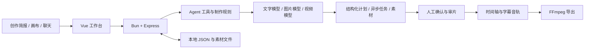

<p align="center">
  
</p>

<h1 align="center">CinePilot</h1>
<p align="center">把故事、镜头和每一次修改，留在同一个创作工作台。</p>
<p align="center">AI Video Agent · 节点画布 · 可控改稿 · 网页与桌面</p>


CinePilot 是面向漫剧与短片制作的 AI Video Agent Demo。创作者可以从故事简报、空白画布或已有素材开始，组织角色与分镜，通过自然语言和可视化编辑调整作品，确认生成结果后再进入成片。

本项目是面向爱奇艺漫剧创作场景的个人研究与产品作品，用于展示需求分析、工作流设计和产品验证。场景名称不表示爱奇艺官方合作、委托或验收。

## 创作流程

1. **说清楚要做什么**：输入故事、角色设定、必须保留的内容，选择风格、画幅和目标时长。
2. **确认制作方案**：检查剧本、角色、场景与分镜，补充参考素材。
3. **在画布上组织生成**：添加文字、图片和视频节点，连接输入，查看模型与生成参数后提交任务。
4. **逐镜修改与审片**：保留已采用版本，生成新候选；只改字幕时复用已有视频，对需要重新制作的镜头单独处理。
5. **剪辑并导出**：排列镜头、裁剪片段、编辑字幕和配乐，预览后导出 MP4。

收费模型调用需要自行配置供应商账号。创建空白项目、整理节点和编辑已有素材不需要先提交生成任务。

## 工作台


网页与桌面共用首页、创作画布、导演助手和时间轴组件。桌面保留原生文件选择与保存入口。上图为实际界面截图，剪辑示例使用已生成的咖啡片段。

## 当前能力与边界

| 模块 | 当前实现 |
| --- | --- |
| 创作简报与策划 | 必填项校验；连接文字模型生成结构化剧本、角色、场景和分镜 |
| 节点画布 | 文字、图片、视频节点，连接、移动、编辑、撤销重做和本地保存 |
| 导演 Agent | 读取项目与画布，通过工具调用准备节点及执行受支持的编辑操作；生成与制作门禁由后端校验 |
| 局部改稿 | 镜头锁定、字段级修改、素材复用及受影响内容的复查状态 |
| 版本与候选 | 新候选与已采用版本分离；显式采用、版本历史和撤销 |
| 模型接入 | DeepSeek 文字模型、OpenAI 图片接口、火山方舟视频接口；权限与可用模型取决于用户配置 |
| 异步任务 | 提交、查询、结果保存、状态展示及待核对保护；远端异常恢复尚需扩大实测 |
| 剪辑与导出 | 时间轴、裁剪、拆分、排序、字幕、已有音频与 BGM；FFmpeg 导出 H.264 MP4 |

**已完成的验收范围**：16 项制作门禁、候选采用、素材复用与导出检查；复用既有真实视频修改字幕，导出 5 秒、1280×720 的 MP4，并完成整段解码检查。画布增加节点、撤销重做与刷新恢复经过浏览器操作验证。详见 [验证记录](docs/verification.md)。

**当前限制**：完整的“两角色、六镜头、30 秒、有对白”漫剧尚未完成验收；跨镜角色一致性仍需实测，自动角色配音尚未接通，首页视觉模板库仍在规划。代码提供 1080p 导出选项，现有导出验收覆盖 720p。当前交付用于本地单用户使用，未提供公开多用户 SaaS 的部署保障。

## 本地运行

准备 Bun 1.3.14 或兼容版本。媒体检查与导出需要系统可用的 FFmpeg、FFprobe；中文字幕需要中文字体。

```bash
git clone https://github.com/YEMIN11238/CinePilot.git
cd CinePilot
bun install --frozen-lockfile
bun run build:server
TOONFLOW_SERVER_HOST=127.0.0.1 bun run start:server
```

打开 `http://127.0.0.1:3000`。以上环境变量写法适用于 macOS/Linux 终端。PowerShell 可先执行 `$env:TOONFLOW_SERVER_HOST="127.0.0.1"`，再运行启动命令。

首次启动后，在界面的“模型设置”中配置文字、图片和视频供应商。仓库不包含 API Key，不需要数据库初始化。项目、画布和素材保存在本地，配置位于数据目录的 `settings.json`，已被 Git 忽略。

详细开发命令、数据路径和桌面构建方式见 [开发说明](docs/development.md)。

## 技术结构



- **界面**：Vue 3、TypeScript、Vite、Pinia、Element Plus、Vue Flow。
- **服务与 Agent**：Bun、Express、Zod、pi-ai / pi-coding-agent。
- **桌面**：Electrobun。
- **媒体**：WebAV、FFmpeg、FFprobe。

| 代码位置 | 职责 |
| --- | --- |
| `apps/web/src/pages/studio/` | 创作首页与项目入口 |
| `apps/web/src/pages/workspace/panels/director/` | 画布、导演助手、分镜审片和时间轴 |
| `apps/server/src/agent/tools/director.ts` | 导演编辑工具 |
| `apps/server/src/utils/director/` | 策划、版本、制作规则、任务与媒体处理 |
| `apps/server/src/lib/directorTypes.ts` | 项目、镜头、版本与任务数据结构 |
| `packages/providers/src/media/` | 图片与视频供应商适配 |
| `apps/desktop/` | 桌面运行与原生文件能力 |

## 许可

源码按 [MIT License](LICENSE) 发布。所包含组件的版权、许可和参考来源见 [开源说明](docs/credits.md)。项目开发使用了 AI 编程辅助；仓库中的能力说明以当前代码及已记录的验证结果为准。
